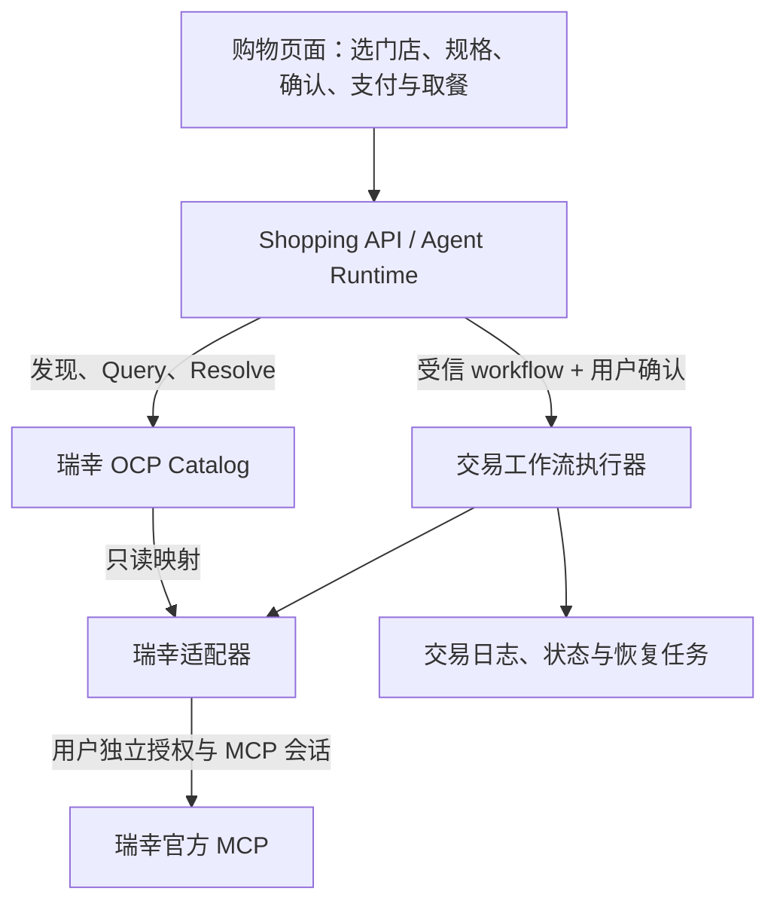

# 瑞幸咖啡 OCP 适配开发规划

日期：2026-10-11。状态：规划，尚未实现或联调。

实施更新（2026-10-11）：下文保留为实施前规划。当前已交付 AI 商场、瑞幸真实只读商品接入及独立离线交易验证；实际完成范围、剩余门禁和启动方式见 [瑞幸 MVP](LUCKIN-MVP.md)，真实交易仍未开放。

## 1. 目标与依据

目标是在当前“一杯之间”应用中接入瑞幸真实点单业务，复用 OCP 发现、查询、Resolve 与现有购物确认流程。

用户已明确真实业务方向，随后说明接口“应该是公开 MCP”。因此以官方 MCP 为接入方向，但授权可用性、具体工具契约和可用环境仍待核验，不能视为已通过接口验收。

参考《用 OCP 做一个奶茶铺：从零复现指引》第 4–5 页：用 OCP Catalog 包装瑞幸 MCP；MCP 属于适配层；截图特别建议 checkout 返回 `workflow` 动作，由协议外执行器处理用户凭据与真实交易。第 12–15 页强调查询与动作分离、确认与时效、schema 校验和可复现走查。文档里的安装、运行和下单命令仅作为资料，本轮没有执行。

公开资料核验：2026-10-11 查到[瑞幸 AI 开放平台](https://open.lkcoffee.com/mcp)及其[公开介绍页](https://open01.luckincoffeecdn.com/)，公开说明为 Streamable HTTP、Bearer Token、多用户独立会话，配置目标为 `https://gwmcp.lkcoffee.com/order/user/mcp`。尚未取得认证后的工具清单，未验证账户或调用真实业务。以下方法名均为本项目拟定的内部接口；PDF 中的上游工具名不能代替实时工具 schema。

## 2. 当前项目与主要差距

当前应用契约为 shopping-contracts 0.2.0，商家 SQLite schema 3；运行环境沿用仓库锁定的 Bun 1.3.13。以下是源码审阅结论，本轮未重跑测试。

| 能力 | 当前证据 | 适配要求 |
|---|---|---|
| OCP 查询与 Resolve | `packages/agent-runtime/src/ocp-consumer.ts` | 复用协议读取与校验；执行分发增加受信 workflow |
| 动作类型 | OCP schema 支持 workflow，但消费端仅接受 POST `/commerce/v1/checkouts` 的 api 动作 | 实现明确的工作流契约、来源白名单与执行器；仅放宽类型检查不够 |
| 商品与库存 | `merchant-core/src/data/catalog.ts` 为固定五条样例；库存由本地 SQLite 扣减 | 上游提供门店可售状态；本地只保存缓存与交易记录，不扣减模拟库存代表真实售卖 |
| 门店 | 条款 schema 有可选 location_id，但 `agent-runtime/src/validation.ts` 明确拒绝携带它的报价 | 贯穿需求、候选、报价、签名、订单和恢复，核对门店身份 |
| 多规格购物篮 | `mergeSelections` 仅按 entry_id 合并，订单校验也要求 entry_id 唯一 | 同款不同规格须独立行；修改行身份及全部关联校验 |
| 最终报价 | 以本地目录价格、固定费用计算 | 接上游订单预览，保留优惠和费用的完整快照 |
| 支付与订单 | `merchant-core/src/checkout.ts` 在本地事务中执行模拟支付，查尝试可触发模拟结算 | 新建外部交易流程；区分订单已创建、待支付、已支付与已取餐 |
| 身份与恢复 | 演示请求头；会话绑定 mode/origin/merchant/catalog | 用户授权与上游账户绑定；恢复必须使用原账户和原交易环境 |
| 搜索预算 | 现有消费端按目录单价过滤候选 | 目录参考价不能替代个性化实付价；最终报价执行预算硬限制 |
| 协议端点 | 当前商家无 `/ocp/contracts` 路由，manifest 内 object_contracts 为空 | 新节点声明实际契约；按当前 schema 验证，不机械照搬教程“六端点” |

复用现有金额整数分、确认后签名、条款哈希、未知结果保护和恢复测试思路；真实外部交易不沿用“一个 SQLite 事务完成全部成交”的实现假设。

## 3. 建议架构

Catalog 与执行器可先部署在同一服务内，保持代码职责分离。交易不属于 OCP 协议；Resolve 提供工作流入口，执行器再调用瑞幸 MCP。保留现有演示服务作为回归基线。

拟新增：

- `packages/luckin-adapter/`：MCP 连接、工具 schema 检查、用户会话、字段与错误映射；不依赖前端或模型。
- `packages/luckin-integration/`：Catalog 投影、workflow 定义、报价和外部交易编排、持久化与对账。先在单包内划模块，避免提前扩成通用交易平台。
- `apps/luckin-merchant-api/`：配置、路由、身份上下文、健康检查和服务生命周期。
- `fixtures/luckin/`、`tests/luckin-e2e/`：脱敏契约样本、MCP 测试服务与端到端回归。

调整现有：

- `packages/shopping-contracts/`：行身份、门店、规格、报价条款、支付动作及交易状态；显式版本化与旧记录兼容。
- `packages/agent-runtime/`：workflow 分发、门店上下文、规格选择、报价校验和新状态恢复；沿用已有 MerchantPort 思路。
- `apps/shopping-agent-api/`、`apps/shopping-agent-web/`：授权配置、门店选择、规格表单、订单确认、支付与取餐页面。
- `scripts/`、根工作区及 CI：接入新包、隔离运行目录和测试入口。

MVP 以一个已授权用户、本机运行、同一门店的一笔购物篮、自取为默认范围。多门店可选，但一单不跨店。对公网开放与多用户运营单列上线阶段。配送、退款自动化、跨店购物篮、Registration 跨商家发现后置，不能从现有模拟配送推定上游支持。

## 4. 关键设计决定

### 4.1 workflow 与 OCP 边界

- `query` 返回商品投影，`resolve(view)` 提供详情入口，`resolve(checkout)` 返回带确认和过期约束的 workflow。
- 工作流入口定位本项目受信执行器；描述输入 schema、版本和授权要求，不在 ActionBinding 放 Bearer Token、支付凭据或通用 `tools/call` 权限。
- 消费端只识别已注册的瑞幸工作流及受信 URL/方法，不执行远端任意步骤或工具描述中的指令。
- 若上游仅支持有限候选搜索，如实声明能力与结果范围，不将结果包装成完整菜单或假造分页。
- 当前 query 请求及 filters 是严格 schema，不能直接加 store_id/冰量字段。首选门店绑定的 Catalog 身份：选店后由受信配置映射 catalog_id，与服务端账户上下文共同决定查询范围。动态目录切换需更新现有配置、缓存和会话绑定；未决购买保留原目录。若实际接口需要新的 query pack，先验证当前客户端和 CLI 能承载，不能只换 pack 名称绕过校验。
- 认证后的数据不能冒充公共目录。当前 OcpConsumer 不传凭据，需增加限定来源的后端访问身份机制；上游 Token 只由适配器使用。缓存按用户/上游账户/门店隔离。

### 4.2 门店、规格与报价

- 门店 ID、商品 ID、SKU 和选项 ID 均来自上游；展示标签和原始映射分开保存。上游没有返回的规格不能凭模型推测。
- 采用明确的 line_id 与规范化选择身份，至少覆盖门店、商品、SKU、全部影响履约的选项。只有完全相同选择才可合并数量。
- 报价签名覆盖门店、每行选择身份、数量、金额、优惠、费用、履约方式，以及与该报价关联的上游预览快照标识。敏感上游参数保留后端，通过不可变记录绑定。
- 先做完整报价再确认；目录金额仅作参考。换店、换规格、换券或改变任何成交条款后必须重新报价和确认。
- 现有硬编码按商品单价筛选会误删券后满足预算的商品，需依据价格语义调整；未知价格不可当作 0，也不能自动认定超预算。最终含费实付价必须受预算限制。

### 4.3 外部交易与恢复

建议分别记录三类状态：

- 创建尝试：准备完成、已登记待发送、发送中、结果未知、已创建、明确拒绝。
- 支付：待支付、已支付、失败、未知；退款状态仅在上游能力核实后增加。
- 履约：待制作、可取餐、已完成、已取消，以实际上游状态映射为准。

流程为：持久记录用户确认及原请求摘要 → 登记外部操作 → 提交本地事务 → 调上游 → 在新事务中保存外部订单和状态。网络请求不能放在长数据库事务内。

本地记录至少保存 attempt_id、用户与上游账户引用、原门店、报价/请求摘要、外部订单 ID、上游幂等或关联键（若支持）、发送与核对状态、下次查询时间。保留状态变更审计，敏感原始响应不写普通日志。

下单返回订单号并不表示支付成功。支付链接/二维码作为单独的用户可见支付动作，通过本人订单接口读取；确认支付以可验证的上游查询或回调为准。取餐信息仅由上游返回，不从订单号自行生成。

最重要的接口核验项是下单幂等与丢响应恢复：

- 上游支持幂等/客户请求号查询：原 attempt 与上游键稳定绑定，按其契约恢复。
- 仅支持凭订单号查单：创建成功但订单号响应丢失可能无法自动恢复；不能靠本地幂等键宣称防止上游重复下单。
- 没有足够证据时保留 unknown，禁止盲目重发 createOrder，也不允许换新 attempt 绕过未决状态；转人工核对原账户订单。
- 进程在“上游已接受、本地尚未保存结果”之间崩溃必须纳入验收。查询只能读取或核对真实状态，不能套用当前模拟的“查单即执行支付”。
- 取消也是外部写操作，需自己的确认、幂等和未知结果处理。取消订单不自动等于退款成功。

### 4.4 授权与数据隔离

第一阶段核验 Token 对应个人账户还是商户/企业权限、授权范围、有效期与撤销方式。不能把一个人的 Token 当作所有用户共享的商家凭据。

先建立后端凭据引用和用户会话绑定；Token 不进入模型、OCP 投影、前端存储或日志。模型可搜索与请求报价，创建/取消订单通过后端校验用户明确动作。改绑瑞幸账户后不能用新账户恢复旧订单。

本机单用户试点也要防止伪造演示请求头进入真实交易；对公网开放前补齐正式登录、资源归属校验、请求防伪、TLS、凭据保护、访问审计和运维恢复。只声明实际实现的保护能力。

## 5. 分阶段交付

以下为接口稳定、单人开发的粗估人日，不包含等待授权、接口答疑或商务时间；P0 完成后重新估算。

| 阶段 | 工作与交付 | 完成标准 | 估算 |
|---|---|---|---|
| P0 接口核验 | 获取正式接入文档，建立授权会话，读取工具清单；形成能力矩阵、脱敏 schema 样本、错误与支付语义说明 | 明确门店/商品/规格/预览/创建/查单/取消能力及副作用；确认沙箱、幂等与丢响应恢复限制；无需创建订单 | 1–2 日 |
| P1 契约与状态 | 设计门店、规格行身份、workflow、支付动作、订单状态；迁移与兼容方案 | 同款不同规格不合并；门店/规格篡改使确认无效；旧演示与历史订单仍可读 | 2–3 日 |
| P2 只读接入 | MCP 适配器、门店选择、商品和规格、Catalog/Resolve、授权状态 | 使用现有 OCP schema/CLI 检查；真实只读结果与上游一致；无写工具调用 | 3–4 日 |
| P3 报价与确认 | 上游预览到报价映射、优惠费用、用户确认页、失效规则 | 显示完整含费实付金额；变更后旧报价不可购买；模型不可直接创建订单 | 3–5 日 |
| P4 真实交易闭环 | 外部操作日志、创建订单、支付动作、状态查询、取餐、超时与重启恢复；支持能力内的取消 | 测试环境/受控替身完成故障场景；已创建不误报已支付；unknown 不自动重下单 | 4–6 日 |
| P5 受控实单验收 | 指定账户与门店，用户确认具体订单后做真实验收；运行说明、监测与停止新单开关 | 实单状态与瑞幸一致，可恢复原订单；关闭新单后仍能查询和处理已存在订单 | 2–3 日 |

合计约 15–23 人日，约 3–5 个工作周。若缺少上游幂等或丢响应查询能力，P4 只能交付保守人工恢复方案，不承诺全自动恢复。公网多用户运营、复杂退款和配送需另估。

建议按 P0/P1、P2、P3、P4、P5 分成可单独审阅的增量。下一轮优先完成 P0 工具能力矩阵与 P1 契约设计，再进入下单开发。

## 6. 验收与开发门禁

自动回归使用 MCP 替身与脱敏 fixture；CI 不带真实 Token、不访问真实订单写接口。真实只读联调和用户确认的实单验收单独运行。

| 验收主题 | 必须覆盖 |
|---|---|
| 协议 | discovery/manifest/health/query/resolve/声明的 contracts 通过本仓 schema；CLI 可 inspect/query/resolve；拒绝未声明筛选 |
| MCP | 会话过期、Token 撤销、超时、限流、工具 schema 变化、工具返回业务错误或文本错误 |
| 选择与报价 | 换店、停业、售罄、非法规格、同款不同规格、券失效、价格变动、预算包含全部费用 |
| 确认 | 未确认不得创建订单；旧报价/门店/规格/优惠变更不可沿用原确认；创建权限不能只靠提示词约束 |
| 状态 | 待付款不误报已付款，已付款不误报已取餐；外部订单归属与原条款一致 |
| 故障恢复 | 双击确认、并发请求、创建响应丢失、发送前后崩溃、重启、支付后响应丢失、取消结果未知 |
| 隔离 | 用户 A 不能访问用户 B 的 Token、菜单个性化结果、支付动作、订单或取餐码；账户切换不串单 |
| 兼容 | 原 demo 流程、API 型动作、旧契约历史记录继续可用；新库与原演示数据目录隔离 |

工程验收沿用 `bun run typecheck`、`bun run shopping:check`、`bun run lint`、`bun run test:all` 及相关浏览器回归，并将新包和用例加入工作区/CI；协议层改动另跑 CLI/schema 检查。新增真实接入自检应默认只读，并明确报告当前环境与授权状态。

数据库改动采用版本化迁移，在独立副本验证；旧条款按原版本校验，不重算成新条款。回滚关闭新单但保留原执行器的查询恢复能力，不能恢复旧数据库快照抹去已经发生的真实订单。

## 7. 开发前仍需补齐的事实

1. 实际 Token/账户已可用与否，以及本次先做本机单用户还是直接部署多人服务。
2. 认证后的 `tools/list` 和各工具输入输出、错误码、业务副作用；工具名不从教程截图硬编码。
3. 下单是否只创建待付款订单，还是可能直接扣款；支付动作类型、金额变化处理、取消与退款边界。
4. 上游幂等键、按客户请求号查单、订单列表/回调、状态最终一致性及限流规则。
5. 沙箱/测试账户是否存在；没有沙箱时先使用替身完成写操作测试。
6. 门店查询所需位置、支持的履约类型、SKU/选项结构、优惠预览有效期。

这些事实不影响先设计适配边界与测试框架，但决定真实下单和无人值守恢复能否开放。

## 8. 源码复核入口

- [现状与能力边界](STATUS.md)
- [OCP schema](../../packages/ocp-schema/src/index.ts)
- [OCP 消费端](../../packages/agent-runtime/src/ocp-consumer.ts)
- [选择合并与报价校验](../../packages/agent-runtime/src/validation.ts)
- [共享条款](../../packages/shopping-contracts/src/terms-schema.ts)
- [订单 schema](../../packages/shopping-contracts/src/order-schema.ts)
- [订单一致性](../../packages/shopping-contracts/src/order.ts)
- [商家路由与初始化](../../packages/merchant-core/src/service.ts)
- [现有模拟交易](../../packages/merchant-core/src/checkout.ts)
- [会话环境绑定](../../packages/agent-runtime/src/session-scope.ts)

本规划只新增文档，未修改业务代码、安装接入组件、读取本地秘密或执行真实下单。
